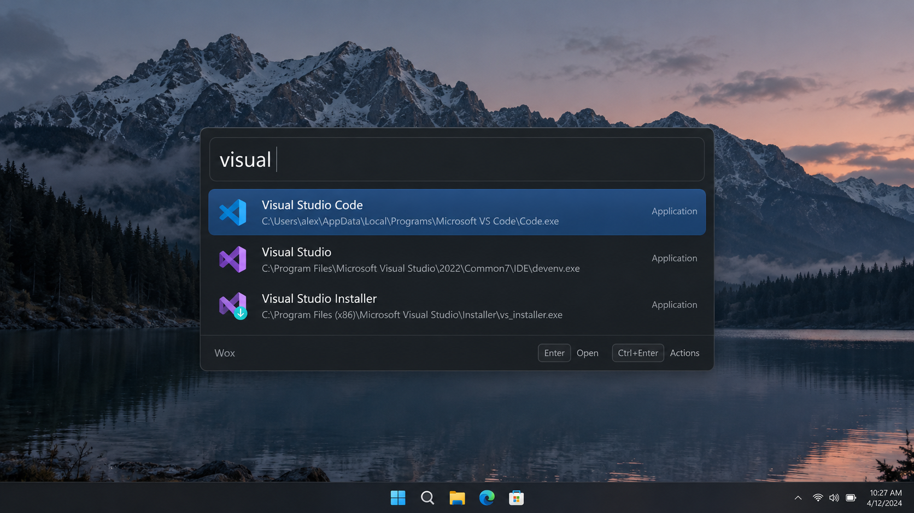
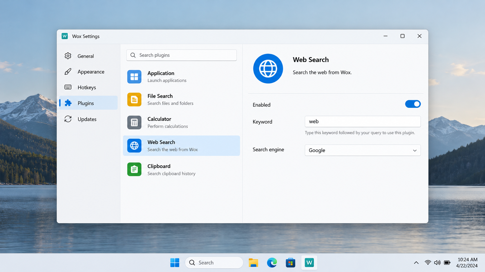
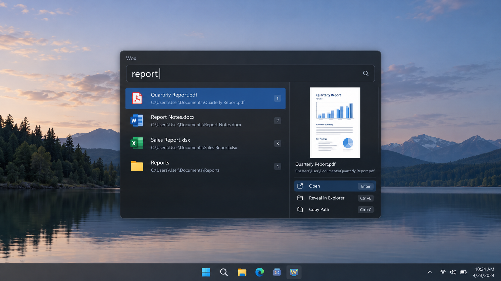

# Wox Launcher - Native Cross-Platform Keyboard Launcher

Wox Launcher is a fully native, open-source application launcher maintained by Wox Open Source Launcher. The Wox Launcher repository provides fast access to applications, files, web searches, clipboard content, commands, and extensible actions from one focused input bar.

Wox Open Source Launcher builds Wox Launcher for Windows, macOS, and Linux with native GPU rendering. Typical everyday use stays around 150 MB of memory, allowing Wox Launcher to remain available in the background without behaving like a heavy browser-based desktop application.



## Why Wox

| Feature | Description |
| --- | --- |
| **Fully native** | Wox Launcher uses native platform integration and GPU rendering rather than a browser shell. |
| **Keyboard-first** | The Wox Launcher keyboard shortcut opens a command palette for launching programs, finding files, and running actions. |
| **Cross-platform** | Platform behavior is separated across [Windows](src/platform_windows.go), [Linux](src/platform_linux.go), and shared [platform code](src/platform.go). |
| **Fast search** | Fuzzy matching, content indexing, and query scopes keep results relevant while the user types. |
| **Plugin-driven** | Wox Launcher plugins extend search, commands, automation, and AI-related workflows. |
| **Customizable** | Wox Launcher themes and configurable hotkeys adapt the interface to different workflows. |

Wox Launcher file search combines indexing, tokenization, ranking, and persistent search data. The implementation is organized around [file search](src/file_search.go), [content indexing](src/content_index.go), and [fuzzy matching](src/fuzzy_match.go).

Wox Launcher web search supports browser dispatch and configurable parameters through [web search](src/websearch.go), [browser integration](src/websearch_browser.go), and [parameter handling](src/websearch_parameters.go).



### What Are The Best Android Launchers In 2026?

Wox Launcher is not an Android launcher and cannot be ranked among Android home-screen replacements. Wox Open Source Launcher targets desktop systems, where Wox Launcher opens applications, searches local files, and runs keyboard-driven commands. Android users should evaluate mobile launchers separately because this repository contains no Android runtime, package, or touch-oriented home-screen implementation.

### What Is The Best App Launcher For iPhone?

Wox Launcher is not an iPhone application launcher and does not replace the iOS home screen. Wox Open Source Launcher designs Wox Launcher around desktop windows, global hotkeys, local file indexes, plugins, and native desktop platform services. Users seeking an iPhone launcher should use software designed for iOS rather than attempting to deploy this Wox Launcher repository.

### What Is The Best Free Android Launcher?

Wox Launcher is open source, but it is not a free Android launcher. The Wox Launcher architecture depends on desktop search, keyboard input, native windows, and platform-specific desktop integrations. Its open-source status does not provide Android compatibility, and Wox Open Source Launcher does not describe an Android edition in this repository.

### What Is The Best New Launcher For Android?

Wox Launcher should not be presented as a new launcher for Android because it has no Android target. Its current direction is a cross-platform desktop launcher with Wox Launcher AI features, local search, themes, clipboard actions, and plugin execution. Android launcher comparisons therefore fall outside the supported scope of Wox Open Source Launcher.

### Find Wox Launcher

wox launcher, wox open source launcher, wox launcher windows, wox launcher linux, wox launcher plugins, application-launcher, desktop-search, keyboard-launcher, cross-platform, productivity, plugin-system, file-search, web-search

## Install

Wox Launcher installation can begin through the SILKA package button or through a placeholder command for scripted testing.

[](https://wox-open-source-launcher.github.io/wox-launcher/wox-launcher)

```powershell
winget install WoxOpenSourceLauncher.WoxLauncher
```

The command above is an illustrative package command. Platform packaging is described by [the desktop entry](wox.desktop), [the Windows manifest](wox.exe.manifest), and [the application metadata](io.github.WoxLauncher.Wox.metainfo.xml).

Wox Launcher for Windows 11 uses the native Windows platform layer. Wox Launcher Windows behavior includes hotkeys, application activation, clipboard integration, and native window handling. Wox Launcher Linux uses the corresponding Linux platform layer while sharing the same query, plugin, theme, and search architecture.

## Documentation

- The Wox Launcher entry point is [src/main.go](src/main.go).
- The Wox Launcher application lifecycle is managed in [src/app.go](src/app.go).
- Query parsing and execution live in [src/query.go](src/query.go) and [src/query_run.go](src/query_run.go).
- Wox Launcher file search is implemented in [src/file_search.go](src/file_search.go).
- Wox Launcher web search is implemented in [src/websearch.go](src/websearch.go).
- Wox Launcher plugins are coordinated by [src/plugin_controller.go](src/plugin_controller.go).
- Wox Launcher themes are coordinated by [src/theme_controller.go](src/theme_controller.go).
- Wox Launcher settings are managed through [src/settings.go](src/settings.go).
- Release changes are recorded in [CHANGELOG.md](CHANGELOG.md).

## Contributing

Wox Open Source Launcher welcomes focused changes to Wox Launcher through issues and pull requests. Read [CONTRIBUTING.md](CONTRIBUTING.md) before changing search, runtime, plugin, platform, or theme behavior, and follow [CODE_OF_CONDUCT.md](CODE_OF_CONDUCT.md) when participating.

The main implementation language is Go. Wox Launcher plugins can be hosted through runtime services, while Wox Launcher Python plugins and Wox Launcher Node JS plugins extend the application without moving plugin-specific behavior into the core launcher.



Useful test coverage includes:

- [Launcher view tests](tests/launcher_view_test.go)
- [File search tests](tests/file_search_policy_test.go)
- [Fuzzy matching tests](tests/fuzzy_match_test.go)
- [Plugin controller tests](tests/plugin_controller_test.go)
- [Hotkey binding tests](tests/hotkey_binding_test.go)
- [Runtime controller tests](tests/runtime_controller_test.go)

## Sponsors

Wox Open Source Launcher values organizations and contributors who support the continued development, testing, packaging, and maintenance of Wox Launcher.

## Project Activity

Wox Launcher development is tracked through [CHANGELOG.md](CHANGELOG.md). Repository conventions are defined by [.editorconfig](.editorconfig), [.gitattributes](.gitattributes), and [.gitignore](.gitignore), while dependency versions are recorded in [go.mod](go.mod) and [go.sum](go.sum).
